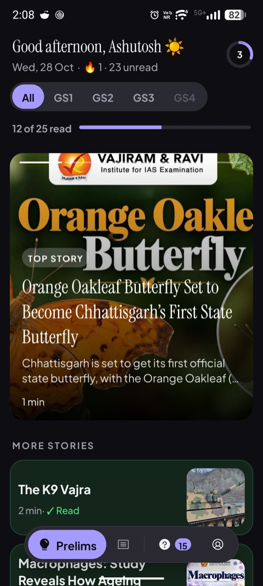
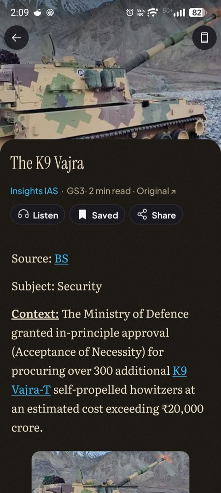
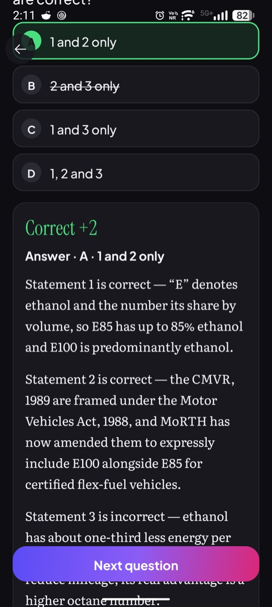
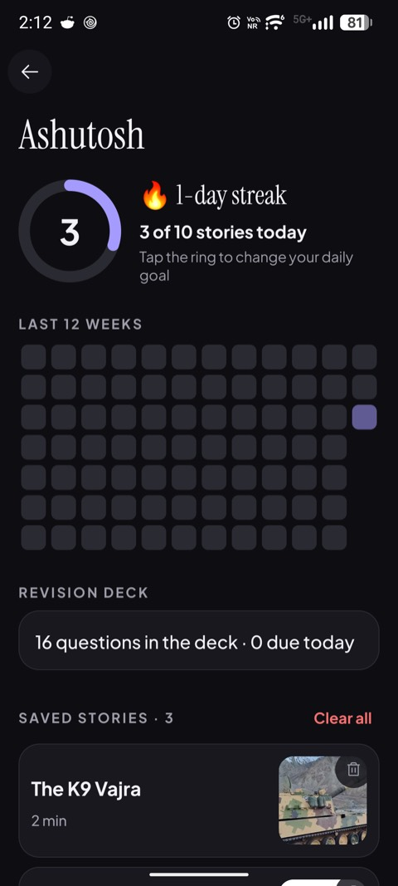
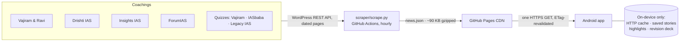

<div align="center">

# UPSC Today

**The day's UPSC current affairs from India's top coachings, in one calm Android app.**
No ads. No login. No clutter. Read, revise, quiz, done.

[](https://github.com/ashusnapx/news/releases/latest/download/UPSC-Today.apk)


[](https://github.com/ashusnapx/news/actions/workflows/scrape.yml)


&nbsp;
&nbsp;
&nbsp;


</div>

---

## The problem

A UPSC aspirant's morning starts on five websites. Vajiram & Ravi, Drishti IAS, Insights IAS and ForumIAS each
publish their own take on the day's news, behind cookie banners, course pop-ups, ads and three taps per article.
The same story gets read four times, and the daily quiz is on yet another page.

## The product

**UPSC Today** collects all of it every hour, groups the same story across coachings, and shows the last 24 hours
in one feed that opens in a fifth of a second. Tap a card and the full article is there, in a reading layout built
for long study sessions. Nothing older than a day, nothing that isn't news.

| | |
|---|---|
| 📰 **One feed, four coachings** | Vajiram & Ravi, Drishti IAS, Insights IAS and ForumIAS, refreshed hourly. When several cover the same story it appears once, with a switch between their versions. |
| 🎯 **Built for the syllabus** | Prelims and Mains tabs, GS1–GS4 filters, and every story tagged with the papers it serves. |
| 📖 **A reading room, not a website** | Full articles in-app with editorial typography, a *paper* mode with a warm stock and grain, listen-aloud, save, highlight, share as an image card, swipe to the next story, full-screen images that rotate to fit. |
| 🧠 **Prelims Mode quiz** | Daily MCQs from Vajiram & Ravi, IASbaba and Legacy IAS, marked like the real paper (+2 / −0.66 / 0), with option elimination, the exam's 72-second pace, streaks and explanations that lead with the reason. Duplicate questions across coachings are kept once. |
| 🔁 **Spaced revision** | Every wrong or skipped answer returns after 1, 3 and 7 days until it's answered right three times. |
| 🔥 **Habit, gently** | A daily goal ring, reading streak, 12-week reading calendar, and at most three reminders a day (each skipped when there's nothing worth saying), plus a Sunday review of what you saved. |

---

## How it works



- **No servers, no database.** A scheduled GitHub Action scrapes, groups and tags, then publishes one static JSON
  file. Every phone downloads that file; 100 users or 100,000, the coaching sites are scraped 24 times a day.
- **No backend to pay for.** GitHub Actions and Pages cover it: **₹0 a month**.
- **Offline by design.** The platform HTTP cache keeps the day's feed and images, so a train with no signal
  still has today's news.

---

## Engineering highlights

**Android app** (`app/`)
- **One dependency** (Firebase Analytics). The UI is plain platform views, with no AndroidX, Compose or image
  library. Image loading, a zoomable viewer, the carousel, the goal ring and the reading calendar are written
  for the purpose.
- **1.8 MB APK**, **~80–190 ms cold start** measured on a Motorola Edge 60 Fusion (Android 17). Three typefaces
  (Instrument Serif, Plus Jakarta Sans, Literata) are subset to Latin, so they add 360 KB, not megabytes.
- **Targets Android 17 (API 37)**, edge-to-edge, predictive back, and 1, 2 or 3 columns from phones to unfolded
  foldables and tablets, with a 720 dp reading column.
- **Accessible:** scalable type, 48 dp touch targets, live regions, TalkBack actions for the carousel, and
  auto-advance off when animations are off.
- **Hardened:** HTTPS only and system CAs only; a script-free WebView for scraped HTML, with no file access and
  no mixed content; strict intent matching; no backup; ad-ID and ad-attribution permissions stripped; R8
  obfuscation and repackaging.
- **Reminders:** inexact alarms with a 30-minute window that the system can batch, re-armed after reboot, and
  expanding into a crossfading carousel of the day's stories.

**Scraper** (`scraper/`)
- **Standard-library Python.** WordPress's REST API over HTML scraping wherever a coaching offers it, so a
  redesign of their pages doesn't break the feed.
- **Cross-coaching story matching** by shared title words after removing filler, so "Special Executive
  Magistrates (SEMs)" and "What are the powers of a Special Executive?" become one story.
- **GS tagging** from the coaching's own markers, falling back to a syllabus keyword map.
- **Quiz extraction** from two different quiz widgets, with explanations normalised into clean blocks
  (paragraphs, sub-headings, nested bullets) and "Statement 1 is correct — …" split one verdict per line.
- **Self-checking:** an offline test suite runs before every publish; a failing source logs a warning and the
  rest still ship.

---

## Privacy

| Collected | How |
|---|---|
| Anonymous feature counts | From everyone, with no install ID and no device details, so a count can't be traced to a person. |
| Detailed usage stats | **Only after the reader agrees**, through Google Analytics for Firebase. Never the advertising ID or Android ID; ad personalisation off. |
| Name, highlights, saved stories | Never leave the phone. Excluded from backup. |

The reader can turn detailed stats off at any time in the **You** tab, which also resets the analytics install ID.
The full policy is in [PRIVACY.md](PRIVACY.md).

---

## Numbers

| | |
|---|---|
| Sources | 4 news coachings, 3 quiz coachings |
| Stories in a day | ~40 |
| Quiz questions in a day | up to ~30, duplicates merged |
| Feed size | ~380 KB raw, ~90 KB gzipped |
| Refresh | hourly, around the clock |
| APK | 1.8 MB |
| Permissions | internet, notifications, re-arm after reboot (no runtime prompt except notifications) |

---

## Tech stack

| Layer | Choice |
|---|---|
| App | Kotlin 2.2, Android platform views, AGP 9.4, min SDK 30, target SDK 37 |
| Scraping | Python 3 standard library (`urllib`, `json`, `html.parser`) |
| Pipeline | GitHub Actions (hourly cron) → GitHub Pages |
| Analytics | Google Analytics for Firebase (opt-in), GA4 Measurement Protocol (anonymous counts) |
| Design | Instrument Serif, Plus Jakarta Sans, Literata; Phosphor Icons |

## Project structure

```
.
├── app/                         Android app
│   └── src/main/
│       ├── kotlin/…/news/        Feed, Article, Quiz, You, Image viewer, Reminders, Store, Share, Analytics
│       └── res/                  layouts, fonts (subset), Phosphor vectors, light/dark/paper palettes
├── scraper/
│   ├── scrape.py                sources, grouping, GS tagging, quiz parsing → news.json
│   └── test_scrape.py           offline self-check, run before every publish
├── .github/workflows/scrape.yml hourly scrape → GitHub Pages
└── docs/screenshots/
```

---

## Build

Requirements: JDK 17+, Android SDK 37.

```sh
./gradlew assembleRelease
adb install app/build/outputs/apk/release/app-release.apk
```

Local-only files the build expects (never committed):

| File | Purpose |
|---|---|
| `app/google-services.json` | Firebase project config (Firebase console → Project settings → Android app `com.ashusnapx.news`) |
| `~/.android/upsc-today-release.jks` | release signing key; back it up, since updates need the same key forever |
| `~/.gradle/gradle.properties` | `releaseStoreFile`, `releaseStorePassword`, `releaseKeyAlias`, `releaseKeyPassword`; optional `countId`, `countSecret` for anonymous counts |

Scraper self-check:

```sh
cd scraper && python3 test_scrape.py
```

Fire a reminder on a debug build:

```sh
adb shell am broadcast --user 0 -n com.ashusnapx.news/.Reminder \
  -a com.ashusnapx.news.REMIND --es slot morning --ez force true
```

---

## Roadmap

- In-app "Update available" prompt for sideloaded installs
- Play Store release
- Hindi edition
- More sources (state PSC current affairs, PIB, The Hindu editorials)
- Home-screen widget with the day's top story
- Image proxy, so coaching CDNs aren't hit once per reader

See [CHANGELOG.md](CHANGELOG.md) for what shipped in each version.

---

## License

**Proprietary. All rights reserved.** The source is visible only because the feed is published from this
repository; see [LICENSE](LICENSE). News content belongs to the coaching institutes that publish it, and the app
always links back to the original. Fonts are licensed under the SIL OFL 1.1, and icons by Phosphor under MIT.
Security issues: see [SECURITY.md](SECURITY.md).

<div align="center">
<sub>Built by <a href="https://github.com/ashusnapx">Ashutosh Kumar</a>: Generative AI Engineer, Bengaluru ·
<a href="https://www.linkedin.com/in/ashusnapx">LinkedIn</a> · <a href="https://ashusnapx.vercel.app/">Website</a></sub>
</div>
